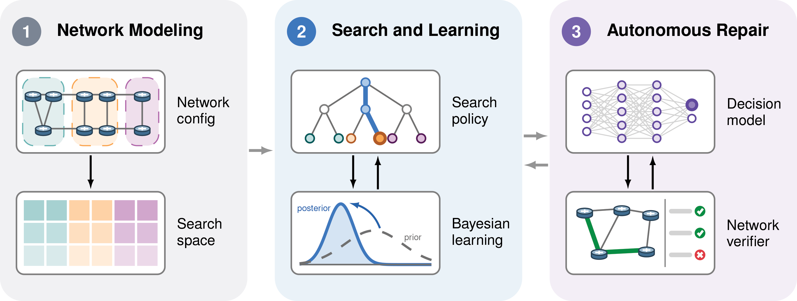

# SONAR

SONAR: (S)earch-(O)ptimal (N)etwork (A)utonomous (R)epair.

## Requirements

- A JDK 17+ to launch Gradle, which is used to build and run SONAR.
- Node.js 22.12+ for the web interface.
- Docker.

## Commands

| Task | Command |
|---|---|
| Fetch Batfish and the Cornetto dataset | `scripts/fetch-batfish.sh`, `scripts/fetch-dataset.sh` |
| Build and run every check | `scripts/check.sh` |
| Run the Java tests (of one module) | `scripts/test.sh [sonar-core]` |
| Format the Java code | `scripts/format.sh` |
| Repair scenarios | `scripts/run.sh repair --scenario scenario-001` (see `scripts/run.sh --help`) |
| Start the web interface | `scripts/web.sh` (`--demo` without the engine), then open `http://127.0.0.1:8080` |
| Develop the web interface | `scripts/ui.sh dev\|build\|test\|lint\|format` |
| Run a benchmark sweep | `scripts/benchmark.sh` (exports with `scripts/benchmark-export.py`) |
| Audit the dataset | `./gradlew :sonar-app:audit -Psonar.audit.scenarios=scenario-001` |
| Check the Lean proofs | `proofs/check.sh` (see `proofs/README.md`) |

The dataset is read from `dataset/main_dataset` and results are written to `output`
(`--dataset`, `--output`). The decision model's API key is read from `OPENROUTER_API_KEY`. The
audits are the `audit`-tagged tests of `sonar-app`; they also need the ground truth in
`../aros/results/ground_truth`.

## Dataset

SONAR is evaluated on the
[Cornetto benchmark](https://huggingface.co/datasets/iprotogeros/cornetto-benchmark): 231
misconfiguration scenarios on networks of 20–754 Cisco IOS routers. `scripts/fetch-dataset.sh`
downloads it into `dataset/main_dataset`. The evaluation metrics are published in
[sonar-cornetto-results](https://huggingface.co/datasets/kimhammar/sonar-cornetto-results).

## Theoretical results

The propositions of the SONAR paper are formalized in Lean 4; see
[proofs/README.md](proofs/README.md) for how to check them and for the scope of each result.

- [Prop. 1](proofs/Sonar/Complexity.lean): a step of SONAR takes `O(n)` operations.
- [Prop. 2](proofs/Sonar/Completeness.lean): SONAR is sound and complete.
- [Prop. 3](proofs/Sonar/Existence.lean): an optimal search policy exists.
- [Prop. 4](proofs/Sonar/Reduction.lean): computing an optimal policy is NP-hard (the reduction from
  min-sum set cover is formalized; the hardness of that problem is cited).

## License

Released under the **Creative Commons Attribution 4.0 International** (CC BY 4.0) license; see
[LICENSE](LICENSE).

© Kim Hammar, Emil C. Lupu, Tansu Alpcan, 2026
